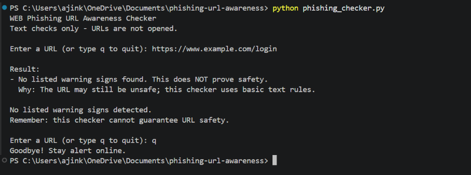
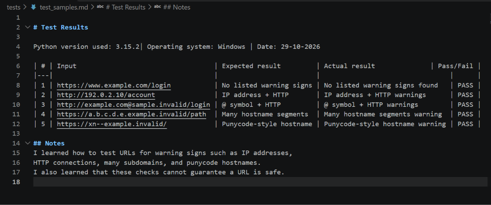

# EWB Phishing URL Awareness Checker 

## Overview
 [Phishing is a type of online scam in which attackers create fake websites or links to steal personal information, such as passwords and bank details. 
 My tool checks URLs for common warning signs, such as IP addresses, long URLs, the @ symbol, and the use of HTTP. It displays warnings and explanations to help users identify potentially suspicious links, but it cannot guarantee that a URL is safe..]
 
## Features
- Detects an @ symbol in the URL
- Flags unusually long URLs (over 100 characters)
- Flags IP-address hostnames- Flags many hostname segments (5 or more)
- Flags punycode-style hostnames (xn--)
- Flags the HTTP scheme
- [A: Loop with Quit:- 
                    Added a while loop so users can inspect multiple URLs
                    without restarting the program. Users can type q, quit,
                    or exit to close the program.]
- [ Improvement D: Explain Each Warning:-
                    Added a REASONS dictionary that explains each warning
                    in simple language.The program prints the explanation                
                    under the corresponding warning.
                    I tested this improvement using sample URLs and checked
                    that each warning displays its explanation.]

## Requirements 
Python 3.10 or later. No extra packages.

## How to Run 
Windows:   python phishing_checker.p
 Mac/Linux: python3 phishing_checker.py

## Example Output:

## Testing
# Test Results
Python version used: 3.15.2| Operating system: Windows | Date: 29-10-2026

| # | Input                                   | Expected result         | Actual result              | Pass/Fail |
|---|                                         |                         |                                 |      |
| 1 | https://www.example.com/login           | No listed warning signs | No listed warning signs found   | PASS |
| 2 | http://192.0.2.10/account               | IP address + HTTP       | IP address + HTTP warnings      | PASS |
| 3 | http://example.com@sample.invalid/login | @ symbol + HTTP         | @ symbol + HTTP warnings        | PASS |
| 4 | https://a.b.c.d.e.example.invalid/path  | Many hostname segments  | Many hostname segments warning  | PASS |
| 5 | https://xn--example.invalid/            | Punycode-style hostname | Punycode-style hostname warning | PASS |

## Notes
I learned how to test URLs for warning signs such as IP addresses,
HTTP connections, many subdomains, and punycode hostnames.
I also learned that these checks cannot guarantee a URL is safe.

## Screenshots
 

## Improvements
1. Loop with Quit:- I added a loop so that I can check multiple URLs without running the program again and again. I also added the `q`, `quit`, and `exit` options to close the program. I tested it by entering different URLs and then typing `q` to exit.
2. Explain Each Warning:- I added a `REASONS` dictionary to explain why each warning is important. I tested it with sample URLs and checked whether the program displayed the explanation below each warning.

## Limitations 
This is an educational tool. It only reads URL text. It does not visit URLs,
scan for malware or prove that a URL is safe.
No warning signs found does NOT mean a URL is safe. 

## Ethical Use 
Use sample strings only. Do not collect credentials.
Do not use this project to deceive anyone or to test websites without permission.

## Author 
[AJINKYA AJTI KUMBHAR],
[Ewb AI POWERED CYBERSECURITY INTERNSHIP],
[EWB Courses]